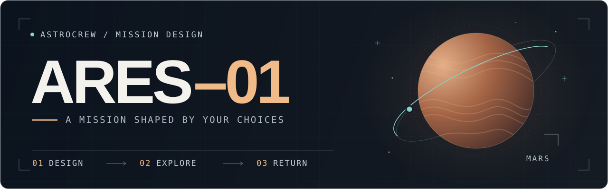
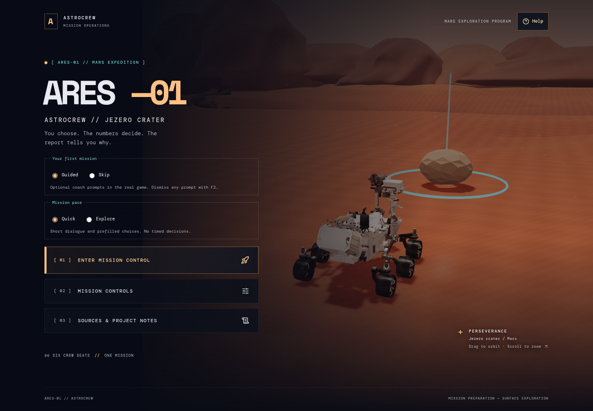

# 

<p align="center">
  <strong>Build the mission. Bring the science home.</strong><br>
  <sub>TEAM ASTROCREW · NASA SPACE APPS 2026 · SPACE MISSION DESIGN GAME</sub>
</p>

<p align="center">
  <a href="https://ares01-astrocrew.vercel.app/"></a>
  &nbsp;
  <a href="https://docs.google.com/presentation/d/1zIt9-3P3KQw-xXMPhGbLWeiW11gltPOr/edit?usp=sharing&amp;ouid=103721580173308071919&amp;rtpof=true&amp;sd=true"></a>
</p>

<p align="center">
  <a href="#what-players-do">Mission</a> &nbsp;·&nbsp;
  <a href="#meet-team-astrocrew">Crew</a> &nbsp;·&nbsp;
  <a href="#controls">Controls</a> &nbsp;·&nbsp;
  <a href="#run-locally">Run locally</a> &nbsp;·&nbsp;
  <a href="#nasa-data-and-resources">NASA data</a>
</p>

ARES-01 is a browser-based Mars mission design game featuring a Perseverance-inspired rover. Lead a six-person virtual crew, make engineering trade-offs, launch, explore Mars and return scientific observations. **Your decisions shape the mission's outcome.**

<table align="center">
  <tr>
    <td align="center"><strong>06</strong><br><sub>CREW</sub></td>
    <td align="center"><strong>03</strong><br><sub>SCENARIOS</sub></td>
    <td align="center"><strong>07</strong><br><sub>INSTRUMENTS</sub></td>
  </tr>
</table>

> **Independent educational project by ASTROCREW.** Not an official NASA product or endorsed by NASA or JPL.

## The challenge

Space mission design balances science against launch capacity, mass, energy, communications, time, cost and risk. ARES-01 makes these trade-offs tangible: a more capable instrument can expand scientific access while increasing resource requirements.

This project addresses the **[2026 Space Mission Design Game challenge](https://www.spaceappschallenge.org/2026/challenges/space-mission-design-game/)** through an interactive, educational mission simulation.

## Play and demo

- **[Play ARES-01](https://ares01-astrocrew.vercel.app/)** — public browser game; no account required.
- **[View the demo](https://docs.google.com/presentation/d/1zIt9-3P3KQw-xXMPhGbLWeiW11gltPOr/edit?usp=sharing&ouid=103721580173308071919&rtpof=true&sd=true)** — ASTROCREW's presentation.
- **[Source code](https://github.com/Kavi-1/Ares01-astrocrew)** — this repository.

The demo covers gameplay, engineering, teamwork, NASA references and technology.

[](https://ares01-astrocrew.vercel.app/)

<p align="center"><sub>Actual game screen · Runs in your browser · No account required</sub></p>

## Meet Team ASTROCREW

ARES-01 is an **original project conceived, designed and directed by ASTROCREW**. The six in-game crew characters represent the team members:

<table>
  <tr>
    <td width="50%" valign="top"><sub>01 / RIHABE</sub><br><strong>Rihabe Ouabine</strong></td>
    <td width="50%" valign="top"><sub>02 / KAVI</sub><br><strong>Kavi Lu</strong></td>
  </tr>
  <tr>
    <td valign="top"><sub>03 / HOUSSAM</sub><br><strong>Choubik Houssam</strong></td>
    <td valign="top"><sub>04 / HUZAIFA</sub><br><strong>Muhammad Huzaifa Saqib</strong></td>
  </tr>
  <tr>
    <td valign="top"><sub>05 / AARYAN</sub><br><strong>Aaryan Shlok</strong></td>
    <td valign="top"><sub>06 / LAUTARO</sub><br><strong>Lautaro Leguizamon</strong></td>
  </tr>
</table>

## What players do

<table>
  <tr>
    <td width="50%" valign="top">
      <p><strong>01 · Choose a role</strong></p>
      Join five rule-based teammates whose specialties shape their proposals.
    </td>
    <td width="50%" valign="top">
      <p><strong>02 · Define the science</strong></p>
      Choose Jezero, Northeast Syrtis or Columbia Hills and rank geology, potential-biosignature context and environmental objectives.
    </td>
  </tr>
  <tr>
    <td valign="top">
      <p><strong>03 · Design the mission</strong></p>
      Choose from seven Perseverance instruments and balance payload, power reserve, communications, launch vehicle, relay orbit, launch window and budget.
    </td>
    <td valign="top">
      <p><strong>04 · Review engineering margins</strong></p>
      Check calculations, revise plans and make risk decisions where allowed.
    </td>
  </tr>
  <tr>
    <td valign="top">
      <p><strong>05 · Launch and explore</strong></p>
      Reach Mars, plan each sol, drive, investigate targets, operate instruments and choose observations to transmit.
    </td>
    <td valign="top">
      <p><strong>06 · Read the results</strong></p>
      Review science returned, resource trade-offs and decisions in the mission dossier; replay with different choices.
    </td>
  </tr>
</table>

Explore **10–11 active field sols** within a **30-sol mission** (20 with a budget override). Continue the expedition to advance quieter days while power and communications remain modeled. Staged instrument readings, crew briefings and a field notebook connect observations to mission decisions. **Guided / Skip** tutorials and **Quick / Explore** pacing support different play styles.

### A mission shaped by engineering

ARES-01 models a Perseverance-class rover powered by an MMRTG. Players balance mass, peak load, battery reserve, science-data volume and relay capacity. The selected reserve (20%, 30% or 40%) is a **protected charge threshold**. Charge follows modeled generation and consumption, and the game distinguishes science **collected** from science **returned to Earth**.

The **$2.7 billion educational budget**, component prices and mission options include game assumptions. See [gameplay specifications](docs/GAMEPLAY.md) for the cost breakdown.

## Controls

### On Mars

| Input | Action |
| :--- | :--- |
| <kbd>W</kbd> <kbd>A</kbd> <kbd>S</kbd> <kbd>D</kbd> / arrows | Drive and steer when the active sol plan permits movement |
| <kbd>Space</kbd> | Brake |
| <kbd>Shift</kbd> | Boost where permitted |
| <kbd>E</kbd> / **Confirm reading** | Confirm an instrument reading while stopped in range |
| <kbd>C</kbd> / <kbd>R</kbd> | Cycle chase, mast and survey cameras / reset the camera |
| <kbd>Esc</kbd> | Pause / resume |
| Drag / scroll | Orbit / zoom the camera |

### In mission control

| Input | Action |
| :--- | :--- |
| <kbd>WASD</kbd> / arrows / click floor | Navigate the crew/workshop room |
| <kbd>E</kbd> | Interact with a nearby crew member |
| Rover inspection markers | Focus on instruments |

> **If the rover does not move:** select **Commit sol plan** when in **Planning** mode. The driving status explains restrictions from mission state, drive allocation, safe mode, damage or terrain. For Columbia Hills, reduce payload mass to pass the landing check.

## Technology

| Layer | Tools |
| :--- | :--- |
| Browser application | **React · TypeScript · Vite** |
| 3D rover, crew, mission rooms and terrain | **Three.js** |
| Client-side state and persistence | **Zustand** |
| UI, model, mission and engineering checks | **Playwright · Node test scripts** |
| Responsive mission-control interface | **CSS** |

Gameplay runs entirely in the browser.

## Run locally

**Node.js 24 recommended.** Run from the repository root:

```bash
pnpm install --frozen-lockfile
pnpm dev
```

Open the URL printed by Vite.

<details>
<summary><strong>Production build and npm commands</strong></summary>

For a production build:

```bash
pnpm build
pnpm preview
```

For npm, use `npm ci`, `npm run dev`, `npm run build` and `npm run preview`.

</details>

## Testing

<details>
<summary><strong>Engineering, campaign and browser checks</strong></summary>

```bash
pnpm build
pnpm test:engineering
pnpm test:preparation
pnpm test:mission-budget
pnpm test:mission-energy
pnpm test:campaign
pnpm test:tutorial
pnpm test:mobility
pnpm test:expedition
pnpm test:model-loading
pnpm test:models
```

Additional browser suites: `test:campaign-ui`, `test:tutorial-ui`, `test:mobility-ui` (WASD at all three sites), `test:expedition-ui`, `test:instruments-ui` and `test:presentation`. Install Chromium with `pnpm exec playwright install chromium`, or set `CHROMIUM_PATH` to an existing installation.

</details>

## NASA data and resources

ARES-01 distinguishes three kinds of inputs:

| Label | Meaning |
| --- | --- |
| **DOCUMENTED** | A value supported by a cited NASA/JPL source |
| **CALCULATED** | A result derived from stated equations and inputs |
| **ASSUMED** | An educational approximation or gameplay parameter |

The game uses static NASA/JPL engineering references, compiled in [src/nasa/data.ts](src/nasa/data.ts), alongside mission-design research:

- [Perseverance instruments](https://science.nasa.gov/mission/mars-2020-perseverance/science-instruments/), [power systems](https://www.jpl.nasa.gov/news/press_kits/mars_2020/landing/mission/spacecraft/power/) and [rover components](https://science.nasa.gov/mission/mars-2020-perseverance/rover-components/): instrument mass, power, data volumes, battery and rover specifications.
- [NASA — Design and Develop Science Missions](https://www.nasa.gov/wp-content/uploads/2025/04/250323-design-and-develop-science-mission.pdf): mission lifecycle, requirements and mission segments, used in supporting documentation.
- [NASA Goddard — Mission Design Lab](https://etd.gsfc.nasa.gov/capabilities/integrated-design-center/mission-design-lab/): trade studies and mission architecture, used in supporting documentation.
- [NASA/JPL — Mars 2020 Perseverance rover](https://science.nasa.gov/mission/mars-2020-perseverance/): rover and mission context.
- [NASA — Mars Perseverance Rover 3D Model](https://science.nasa.gov/resource/mars-perseverance-rover-3d-model/): reference content for the adapted rover model.

Further reading: [Engineering equations](docs/NASA_ENGINEERING.md) · [Scientific provenance](docs/SCIENTIFIC_PROVENANCE_AND_EQUATIONS.md) · [Challenge alignment](docs/SPACE_APPS_CHALLENGE_ALIGNMENT.md).

**Educational scope:** Terrain, scenarios, hazard factors, cost allocations and some observation schedules are game models. They are not NASA-validated flight plans. Potential biosignature context does not establish evidence of life.

## Assets, rights and credits

**Team-created assets:** ASTROCREW designed the six crew-character models, original visual assets and game presentation with AI assistance.

**NASA-origin rover:** The adapted model incorporates NASA/JPL-Caltech content matching the official [Perseverance model](https://science.nasa.gov/resource/mars-perseverance-rover-3d-model/). Its intermediate editing history remains under review.

See [asset licensing and attribution](docs/ASSET_LICENSING_AND_ATTRIBUTION.md) for the inventory, third-party notices and outstanding clearance. NASA and third-party assets retain their respective usage terms.

## Originality and AI-assisted production

**The idea and engineering direction are original ASTROCREW work.** The team defined the scientific objectives, directed implementation and reviewed the results.

**OpenAI Codex and ChatGPT** assisted with code, game content, 3D assets, iteration, testing, debugging, deployment and documentation. The team determined how to apply NASA/JPL scientific references.

## Project documentation

<details>
<summary><strong>Browse the design, engineering and implementation references</strong></summary>

| Reference | Contents |
| :--- | :--- |
| [Gameplay specification](docs/GAMEPLAY.md) | Authoritative gameplay specification. |
| [NASA engineering](docs/NASA_ENGINEERING.md) | Engineering models and NASA sources. |
| [Engineering decisions](docs/ENGINEERING_DECISIONS_U1_U11.md) | Proposed choices and assumptions, including which require approval. |
| [Open decisions](docs/OWNER_APPROVAL_ITEMS.md) | Unresolved decision and approval register. |
| [Requirements traceability](docs/COMPLIANCE_MATRIX.md) | Original baseline classifications may predate recent code changes. |
| [Interface report](docs/ARES01_UI_REDESIGN_REPORT.md) | Interface changes, screenshots and testing notes. |
| [Rover movement report](docs/ROVER_MOVEMENT_FIX_REPORT.md) | Driving and sol-plan interaction repair. |

</details>

> **Current limitations**<br>
> Full mission integration, low-end GPU performance and asset clearance remain subjects of release validation. Older audits describe earlier versions; consult the running build and current tests for present behavior.

---

<p align="center">
  <strong>ARES-01 · TEAM ASTROCREW</strong><br>
  <sub>Build the mission. Bring the science home.</sub>
</p>
