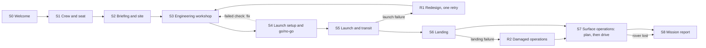

# ARES-01 Gameplay and Mission Logic (Workstream 3)

The source of truth for game rules. Rover data and equations ("Milestone 4"): [NASA_ENGINEERING.md](NASA_ENGINEERING.md). Look, assets and audio: [VISUALS.md](VISUALS.md). Setup and controls: [README.md](../README.md).

## 1. Locked Design Rules

| Rule | Decision |
| --- | --- |
| Mission and rover | A Mars surface mission using NASA's Perseverance rover (Mars 2020). The platform is fixed: rover body, MMRTG power, entry/descent/landing system and cruise stage. The player chooses which of Perseverance's 7 science instruments fly (Mastcam-Z, SuperCam, PIXL, SHERLOC, MOXIE, MEDA, RIMFAX), plus the launch, relay orbit and operations decisions below. All rover data comes from [NASA_ENGINEERING.md](NASA_ENGINEERING.md). ARES-01 is the game's name for the mission |
| Playthrough length | 6 to 10 minutes; target about 9 minutes |
| Surface play | Hybrid: each sol starts with a plan (turn-based, no timer), then the player drives the rover live with WASD or the arrow keys to reach and scan targets. Sols without a target auto-advance |
| Mission events | 2 to 3 per run, scheduled by the scenario, not rolled |
| Luck | None. Every outcome is computed from engineering margins using the Milestone 4 equations and limits ([NASA_ENGINEERING.md](NASA_ENGINEERING.md)) |
| Crew | The player plays one of the 6 crew seats; the other 5 are bots that propose decisions and comment. Bots follow fixed rules, never roll dice, never override a failed check, and never lock the player's options: the player can always accept, ask to revise, or take over. Each seat has a short storyline and the crew give each other orders, but neither changes the physics or the score rules (section 7) |
| Failure | The player is told at once and keeps playing. A launch failure sends the player back to the engineering workshop to redesign (one retry); a landing failure continues with a subsystem lost; the final report says FAILED and names the cause |
| Onboarding | A skippable guided first run teaches the rules inside the real game. It adds at most 90 seconds, is not counted in the 6 to 10 minute target, and never changes the rules or the score (section 8) |
| Real versus fiction | Every threshold carries a tag: documented, calculated or assumed. Anything without a source is a placeholder the owner must source |
| Budget | Every mission has a fixed budget set by the scenario. The total cost of platform, instruments, launch vehicle, relay orbit and operations must fit inside it. Budget is a margin check like mass or power (section 4): over budget blocks launch unless the player accepts the risk, and the consequence is shown before they confirm |

### Pacing: 6 to 10 minutes is a target, not a limit

The times in the state table are Quick-mode targets for a first-time player. A slower player can take as long as they want:

- **No real-time pressure.** Every decision screen (engineering, go/no-go, events) waits for the player. Nothing has a countdown; only the cinematic beats are timed.
- **Skippable cinematics.** Launch, landing and dialogue can be skipped or sped up; subtitles advance on a key press.
- **Surface operations: plan, then drive.** Each sol has two parts:
  1. **Plan** (no timer): the sol energy plan (D11), target choice and any event responses, with the usual bot proposals and team review.
  2. **Drive** (live): the player drives the rover with WASD or the arrow keys (Space brakes, E scans) to reach and scan the target. The drive share of the energy plan is the energy available while driving.

  The sol ends when the player presses "End sol" or the planned drive energy runs out, never on a timer, so thinking time stays unlimited. Data is then transmitted and the next sol starts. Only sols with a target are driven live (about 4 to 6 per run); the others auto-advance in seconds, with a "Skip to next target" button.
- **Autosave at the start of every stage**, so an interrupted player resumes exactly where they stopped.
- **Pace setting (D13).** Quick is the default; Explore adds the full dialogue, the field notes journal and all hints. It changes pacing only, never the rules or the score.
- **Two kinds of time.** Mission time is measured in Mars days (sols) and is a game resource; the player's real time is separate and unlimited.
- **QA check:** a first-time player finishes Quick mode in 6 to 10 minutes, not counting the optional tutorial (section 8); Explore mode has no limit. A run with a launch failure adds about 3 minutes (the redesign R1 plus a second S4 and S5), so the target applies to a run without that failure.

## 2. Mission Flow and States

The diagram below shows how the game moves between stages and where each failure leads.

Solid arrows are the normal path. The dotted arrow is the pre-launch fix loop; R1 and R2 are the reduced-mission paths.

### State table

| ID | Stage | Target time | Player input | Saved | Next |
| --- | --- | --- | --- | --- | --- |
| S0 | Welcome and tutorial setting (optional) | 30 s | Choose Guided or Skip | tutorialMode | S1 |
| S1 | Crew and seat | 30 s | Pick the seat to play | seat | S2 |
| S2 | Briefing and site | 40 s | Pick site; rank 3 objectives | site, objective ranking | S3 |
| S3 | Engineering workshop | 120 s | Instruments, power profile, downlink strategy | loadout, profile, link strategy | S4 |
| S4 | Launch setup, review, go/no-go | 50 s | Vehicle, window, relay orbit, handling of failed checks | vehicle, window, relay orbit, accepted risks | S5 |
| S5 | Launch and transit | 50 s | none (watch; advisers comment) | launch result | S6 or R1 |
| S6 | Landing | 15 s | none (result computed) | landing result | S7 or R2 |
| S7 | Surface operations | 150 s | Sol plans; live driving (WASD or arrow keys) to targets and scanning; answers to events E1, E2 and E4; sampling decision | event log, data returned, rover position | S8 |
| S8 | Mission report | 45 s | Read; export; replay | final report | End |
| R1 | Redesign after a launch failure | 90 s | Edit the rover in S3, then S4, with the failed check locked against override | redesigned loadout, launchAttempt | S3, then S4 and S5 again (second attempt) |
| R2 | Damaged operations (after a landing failure) | within S7 | Same as S7 with a subsystem lost | damaged subsystem | S7 |

A rover lost on the surface (energy at zero for 3 sols in a row) is the only case where play stops early; the game ends there and goes straight to S8.

## 3. Player Decisions and Consequences

| ID | Decision | Options | What it changes | Owner seat |
| --- | --- | --- | --- | --- |
| D1 | Crew seat | 6 crew | Which decisions you make yourself; the other 5 crew become bots (section 7) | Player |
| D2 | Landing site | 3 scenarios | Terrain hazards, available objectives, landing hazard | Geologist |
| D3 | Objective ranking | order of 3 | Score weights (0.5, 0.3, 0.2) | Astrobiologist |
| D4 | Instruments | subset of Perseverance's 7 | Mass, peak power, data per sol, cost against the budget, which objectives are possible | Systems Engineer |
| D5 | Power profile and reserve | 20, 30 or 40 percent battery reserve | Sol energy budget and safe-mode risk | Power Engineer |
| D6 | Downlink strategy | relay passes or direct to Earth | Data capacity per sol; relay passes follow the orbit chosen in D15 | Communications Engineer |
| D7 | Launch vehicle | 3 vehicles | Mass capacity and cost; a bigger vehicle fits more mass but uses more of the budget. Its orbital capability is the mass it can send to Mars, which must cover the rover plus any relay orbiter (D15) | Systems Engineer |
| D8 | Launch window | 3 windows | Arrival season and lighting | Mission Director |
| D9 | Failed check handling | fix, drop an instrument, or override | Override creates an accepted risk (section 4) | Mission Director |
| D10 | Event responses | 2 or 3 options each | Energy, data or objective access (section 6) | Owner of the event (section 6) |
| D11 | Sol energy plan | allocation across drive, science, transmit | Objectives completed, margin left; the drive share is the energy available while driving live | Power Engineer |
| D12 | Sampling decision | examine the unusual rock or move on | Energy cost versus science value | Astrobiologist |
| D15 | Relay orbit | existing orbiters, own elliptical relay, or own areostationary relay | Relay passes per sol, data returned, E2 impact, budget, launch mass (see "Relay orbit options" below) | Communications Engineer |

The owner seat makes the decision. If that seat is yours, you decide; otherwise the matching bot proposes and you review it (section 7).

**D13 Pace setting** (chosen at S1): Quick (about 9 minutes, short dialogue, defaults pre-filled, bot proposals pre-selected so one press accepts the team plan) or Explore (no time pressure, full dialogue, field notes and all hints). Owner: the player. It changes pacing only, never the rules or the score.

**D14 Tutorial setting** (chosen at S0): Guided (coach prompts, section 8) or Skip. Guided is the default on a player's first launch; Skip is the default afterwards. Owner: the player. It changes the prompts only, never the rules or the score.

### Relay orbit options (D15)

The rover sends most of its data to Earth through a satellite orbiting Mars. Where that satellite orbits decides how often and how long the rover can talk to it. Perseverance itself relays mainly through orbiters already at Mars, such as Mars Reconnaissance Orbiter.

| Option | Orbit | Cost (USD million) | Launch mass | Relay passes per sol | Data per sol | E2 link window loss | Teaches |
| --- | --- | --- | --- | --- | --- | --- | --- |
| O1 Existing orbiters (default) | Low orbit, about 300 km; passes overhead briefly | 0 | none added | 1 pass of about 8 minutes | about 960 Mbit | Loses that sol's only pass: all data waits a sol | Free and proven, but low coverage |
| O2 Own relay, elliptical orbit | Low over the site, high away from it; slow near the top | 80 | relay orbiter added | 3 passes | about 2,880 Mbit | Loses 1 of 3 passes | More coverage costs budget and launch mass |
| O3 Own relay, areostationary orbit | About 17,000 km, matching Mars's rotation so it stays above the site | 140 | heaviest relay, needs the most fuel | continuous contact at a lower rate | about 1,800 Mbit | Short outage only: half that sol's data still returns | Always in contact, but far away means a slower link and the highest cost |

**Tags.** The 300 km low orbit is documented for Mars Reconnaissance Orbiter (member 2 to cite). The areostationary altitude is calculated from Mars's rotation period. The 2 Mbps UHF rate and 8-minute pass match the current Milestone 4 assumptions. Pass counts, costs and data per sol for O2 and O3 are assumed for gameplay; relay orbiter masses are placeholders for member 2.

**Balance.** O1 keeps the budget balance in section 4 unchanged, so a player who ignores orbits still has an easy-to-medium game. O2 and O3 are upgrades: they return more data but cost about one to three instruments in budget and may need a bigger launch vehicle. Member 2 should set data generation so a typical design fits O1, while a full instrument load produces more data than O1 can send. That makes the orbit choice matter without making it mandatory.

## 4. How Outcomes Are Decided (No Dice)

Every outcome comes from a **margin check**: the design value compared with a limit. The checks reuse the Milestone 4 validation rules.

| Check | Limit (source) | If failed and overridden, the deterministic consequence |
| --- | --- | --- |
| Launch mass (rover plus relay orbiter, if any) versus launch vehicle | vehicle capacity to Mars (documented vehicle data, or placeholder) | Payload cannot reach the transfer trajectory: launch failure |
| Mass and site hazard versus landing capability | landing capability and site hazard (member 4 and member 2 to supply; placeholder until sourced) | Hard landing: one subsystem lost |
| Peak electrical load | 900 W documented peak demand | Brownout on the first high-load activity: that instrument goes offline |
| Energy balance per sol | generation minus load, with battery reserve | Safe mode on the first sol with a deficit; 3 in a row loses the rover |
| Data versus link capacity | rate times pass time | Excess data is dropped; those observations score zero |
| Terrain capability | 30 degree slope and 0.40 m obstacle limits | Mobility damage if the player routes through such terrain |
| Total cost versus mission budget | scenario budget; costs of platform, instruments, vehicle, relay orbit and operations (proposed values below; member 2 to confirm) | Operations funding is cut: surface operations are shortened from 30 to 20 sols, so fewer objectives can be completed |

**Rules**

1. Without an override, no failure can occur: the game only blocks launch while a check fails and tells the player why.
2. An override is an **accepted risk**: the matching consequence in the right-hand column is applied at the phase it affects. Nothing is random.
3. The game never invents an unexplained failure. The report states this, because real missions also carry small random failure risk that the game does not simulate.
4. Mission time is a resource: surface operations last 30 sols (20 if an over-budget design was launched). Sols with a target are driven live; the rest are simulated in a few seconds each.

### Budget values (starting proposal for member 2)

**Mission budget: USD 2,700 million (documented).** This is NASA's published Perseverance total: about USD 2.4 billion to build and launch plus about USD 300 million to land and operate ([NASA/JPL quick facts](https://www.jpl.nasa.gov/news/press_kits/mars_2020/launch/quick_facts/); [Planetary Society](https://planetary.org/space-policy/cost-of-perseverance)). Target difficulty is easy to medium. The real Perseverance design (all 7 instruments, heavy vehicle, existing orbiters) costs exactly USD 2,700 million, so it fits at 100 percent, as it did in reality.

| Cost item | USD million | Tag |
| --- | --- | --- |
| Fixed platform: rover body, entry/descent/landing system, cruise stage | 1,855 | Calculated: NASA's documented USD 2,400 million to build and launch, minus the heavy launch vehicle (245) and all 7 instruments (300) |
| Operations | 300 | Documented |
| SuperCam / SHERLOC / PIXL / MOXIE | 55 / 50 / 50 / 45 | Assumed (per-instrument costs are not published); scaled by size and complexity |
| Mastcam-Z / MEDA / RIMFAX | 40 / 30 / 30 | Assumed |
| Launch vehicle: light / medium / heavy | 120 / 180 / 245 | Assumed, anchored to NASA launch awards: USD 117 million (Psyche), 178 million (Europa Clipper), 243 million (Mars 2020) |
| Relay orbit: existing / own elliptical / own areostationary | 0 / 80 / 140 | Assumed (D15) |

**What the player sees.** The fixed platform and operations (USD 2,155 million) are shown locked, so the budget bar shows the **flexible USD 545 million** that instruments, the vehicle and the relay orbit spend. Every choice then moves the bar visibly.

**Balance check.** With the existing orbiters (O1), every design fits: all 7 instruments (USD 300 million) on the heavy vehicle (USD 245 million) use exactly the flexible USD 545 million. The budget bites when the player buys an own relay (D15): O2 (USD 80 million) or O3 (USD 140 million) must be paid for by dropping instruments (for example SuperCam and SHERLOC, or three smaller ones) or by flying a lighter vehicle if the mass check allows it. This teaches why Perseverance relies on orbiters already at Mars. A tighter budget belongs in a scenario setting (for example a cost-capped mission), not in changed real numbers. Member 2 should confirm this still holds once the vehicle mass capacities are set.

## 5. Failure and the Reduced Mission

| Failure | What the player sees | How the game continues |
| --- | --- | --- |
| Launch failure (S5) | Voiced crew reaction and the exact cause (for example "payload mass exceeded vehicle capacity by 22 kg") | R1: the player returns to the engineering workshop (S3) to redesign the rover, then repeats S4 and S5 once |
| Landing failure (S6) | Cause and the lost subsystem | R2: the rover works without that subsystem (for example no mobility means stationary science only) |
| Rover lost on the surface | Cause (energy at zero for 3 sols) | Straight to the report |

**Launch retry rules (R1)**

1. **One retry per run.** The launch can fail once; the player redesigns and launches again (`launchAttempt` goes from 1 to 2).
2. **Nothing is lost.** S3 opens with the previous loadout and settings loaded. The failed check is highlighted with its exact numbers (for example, 22 kg over the vehicle limit). Bot owners re-propose against the failed check, and the player reviews them as usual.
3. **The cause is locked.** On the retry the check that caused the failure cannot be overridden: the player must fix it or drop an instrument. This means the second launch cannot fail for the same reason, and the retry always ends in a launch.
4. **Everything is recomputed.** All other checks are re-evaluated against the new design, and the accepted-risks list is rebuilt from the player's new choices in S4.
5. **The result stays honest.** The report headline is still MISSION FAILED, with the first launch in the cause chain; what the player achieves after the retry is shown as the recovery tier.

**Report rule:** if any failure above occurred, the headline is **MISSION FAILED**, followed by the cause chain (which decision, which check, which override, which order was refused). The reduced-mission result is shown separately as the recovery tier.

## 6. Event Catalogue (2 to 3 per run)

Events are scheduled by site and window, so the same design always gets the same events. Effects use Milestone 4 equations; values marked TBD must come from member 2 or member 4.

| ID | Trigger | Player choice | Effect | Data needed |
| --- | --- | --- | --- | --- |
| E1 Route hazard | The planned route, or the rover while driving live, reaches a slope above 30 degrees or obstacles above 0.40 m (documented limits); always scheduled in S7. While driving live, the rover stops at the limit and E1 opens; it never crosses on its own | Reroute, or cross anyway | Reroute costs extra drive energy (distance times energy per metre); crossing risks mobility damage | Terrain map per site (member 4) |
| E2 Link window loss | Always scheduled in S7: one relay pass is unavailable | Reprioritize which data goes first, or wait | Capacity for that sol = rate times remaining pass time; the rest waits in storage. How much is lost depends on the relay orbit (D15): all of that sol's pass with O1, 1 of 3 passes with O2, a short outage with O3 | Pass times per orbit (member 2) |
| E4 Low-energy alert | Fires only if the sol plan would drop the battery below the chosen reserve | Cut a load, or accept safe mode | Cutting loads preserves energy; accepting safe mode skips the next sol | Energy model (member 2) |

E1 and E2 always occur; E4 occurs when the design and choices create the condition, giving 2 or 3 events. Each response belongs to the owner seat: E1 to the Geologist, E2 to the Communications Engineer, E4 to the Power Engineer. A bot owner proposes and the player reviews it (section 7).

## 7. Crew Seats, Bots, Orders and Storylines

The player takes one seat and works with the other five crew, who are bots. The crew collaborate on every decision, but the player can always take it back.

### How the seats work

1. **One seat per player (D1).** At S1 the player picks 1 of the 6 crew. The other 5 are bots.
2. **Owners decide.** Each decision has an owner seat (section 3). If it is your seat, you make the decision. If it is a bot's seat, the bot proposes it.
3. **Bots follow rules, not dice.** A bot's proposal comes from fixed rules and the engineering margins, so the same design and choices always produce the same proposals. There is no randomness and no machine learning.
4. **Team review.** For every bot decision the player sees the proposal with a one-line reason that quotes the real margin. The player can:
   - **Accept** it;
   - **Ask to revise**, by choosing one priority (more science, more safety margin, or less mass and cost); the bot recomputes once per priority;
   - **Take over**, and make the decision on the same screen as if it were their own seat.

   Nothing is locked.
5. **Bots never override.** A bot proposal never contains a failed check or an accepted risk. Only the player can choose an override, by taking over D9.
6. **Bots push their own domain.** Each bot optimises for its own priority (table below), so a proposal can sit close to a limit and conflict with another crew member. The crew comment on it, and the player resolves it.
7. **No seat is stronger.** Every seat can reach 100 points. The seat only changes which decisions the player makes and which screens they control.
8. **Quick mode.** A single "Accept team plan" button accepts every pending proposal at a team review. Proposals accepted this way are not marked reviewed, so they earn no decision-quality points (section 9).
9. **Debrief.** At S8 each crew member gives one line about their own domain.

### Seats and bot proposal rules

Each seat is a named crew member, matching `src/data/crew.ts`: Kavi (Mission Director), Lautaro (Geologist), Rihabe (Astrobiologist), Aaryan (Systems Engineer), Houssam (Power Engineer) and Huzaifa (Communications Engineer).

| Seat | Decisions owned | What the bot optimises when it proposes | Example proposal |
| --- | --- | --- | --- |
| Mission Director (Kavi) | D8, D9, budget | Fewest red checks, including the budget check. Picks the window with the best margins; fixes or drops, never overrides | "Window B has the best energy margin. Dropping RIMFAX clears the mass check." |
| Geologist (Lautaro) | D2, E1 | Safest terrain first, then layered rock | "I would take the south route. The north slope is above the limit." |
| Astrobiologist (Rihabe) | D3, D12 | Highest science value; pushes for more instruments and sampling | "Rank biosignatures first. A sample costs energy, but it is our best science." |
| Systems Engineer (Aaryan) | D4, D7 | Keeps the mass margin at 10 percent or more; smallest vehicle that fits | "The medium vehicle fits with 8 percent spare. I would not add a fourth instrument." |
| Power Engineer (Houssam) | D5, D11, E4 | Highest battery reserve that still leaves the plan feasible; cuts loads first | "40 percent reserve. I would skip the drive on sol 12." |
| Communications Engineer (Huzaifa) | D6, D15, E2 | Data at or below link capacity; prefers relay passes; picks the cheapest relay orbit that can carry the planned data | "Relay passes. Direct to Earth cannot carry this much data." / "The existing orbiters cannot carry this payload's data. An elliptical relay costs USD 80 million but triples our passes." |

The rules in the third column are the design intent. Member 2 provides the numbers and checks they need (section 11).

### Seat storylines

Every seat has a short personal story told in three beats. The mission, the objectives and the scoring are the same for every seat; the story is that seat's view of the mission.

1. **Same mission.** A storyline never changes a limit, a consequence or the physics. It changes dialogue, the crew's reactions and the debrief.
2. **Three beats per seat.** Beat A happens in preparation (S3 and S4). Beat B happens at launch and landing (S5 and S6): the player does nothing and the crew react to the result. Beat C happens on the surface (S7).
3. **Two branches per beat.** Each seat has one measure (table below). At each beat the branch is **Kept** if the measure is healthy so far and **Strained** if not. The measure is computed from the checks, so there is no dice.
4. **Seat result at S8.** Every seat shows Kept or Strained with a debrief line. The player's own seat gets a fuller "Your story" paragraph.
5. **Replay value.** Playing another seat shows the same mission from a different chair, with different decisions, different orders and a different story.

| Seat | Personal stake | Beat A (preparation) | Beat C (surface) | Measure (Kept when) |
| --- | --- | --- | --- | --- |
| Mission Director | Owns the call to go | Calls go/no-go; can order a fix on any red check | Holds the team together through the events | No accepted risk caused a consequence |
| Geologist | Wants the layered-rock site | Argues for the site against the landing hazard | Routes the rover through E1 | No route crossed a terrain limit |
| Astrobiologist | Wants a biosignature result | Lobbies for instruments that serve the top objective | Makes the sampling decision (D12) | The top-ranked objective returned data |
| Systems Engineer | Wants a safe, light rover | Defends the mass margin | Watches the hardware through brownouts and damage | Mass margin stayed at 10 percent or more at go/no-go |
| Power Engineer | Keep the rover alive | Sets the battery reserve | Runs the sol energy plan and E4 | No safe-mode sol |
| Communications Engineer | Bring the data home | Chooses the relay orbit and downlink strategy | Reprioritises data in E2 | No data was dropped |

### Orders: who commands whom

An order is a short structured request from one seat to another. Orders are triggered by margins, never by chance, and they appear at the team review.

1. **Receiving.** When a bot orders the player's seat, the player can **Obey**, **Counter** (a smaller step, such as cutting one load instead of two) or **Refuse**. Refusing is allowed: the margin stays as it is, the bot comments, and any consequence follows from section 4.
2. **Giving.** The orders the player gives to bots are the "Ask to revise" priorities. A bot obeys unless the order would create a failed check. Then it refuses, gives the reason and proposes the nearest safe option. Bots never break a limit to obey.
3. **Chain of command.** The Mission Director outranks every seat and has one extra order, **Order a fix**, on any red check at go/no-go. Bots must obey it by picking the nearest safe option. If the player is the Director, the player issues it; if a bot is the Director, it issues it to the player when the player owns the red check. All other seats can only request.
4. **Limits.** At most one order per station in each direction, so a clean design produces few orders. A player only receives orders about decisions their own seat owns.
5. **Quick mode.** "Accept team plan" obeys every order the player has received.
6. **Report and score.** A refused order that is followed by the consequence it warned about is named in the cause chain. Orders the player obeyed or countered count as hints acted on in the teamwork score.

| From | To | Triggered when | The order | If obeyed | If refused |
| --- | --- | --- | --- | --- | --- |
| Mission Director | Owner of the red check | Any red check at go/no-go | "Fix this check before we go." | The owner fixes it or drops an instrument; launch can proceed | The check stays red; only an override can launch (accepted risk) |
| Systems Engineer | Astrobiologist | Mass margin under 10 percent | "Drop one instrument." | The instrument is removed and the margin recovers | The margin stays amber and may turn red at go/no-go |
| Power Engineer | Seat owning the biggest load | Energy margin under 10 percent on a sol, or E4 | "Cut one load." | Energy is preserved and there is no safe mode | Safe mode on the next sol (E4) |
| Communications Engineer | Astrobiologist | Data above link capacity | "Choose which data goes first." | The chosen data returns; the rest waits | The excess data is dropped (section 4) |
| Astrobiologist | Power Engineer | D12, when there is enough energy | "Spend the energy on the sample." | The sample is taken and its energy cost applied | The sample is skipped and its science value is lost |
| Geologist | Power Engineer | E1, route hazard | "Reroute; I need the drive energy." | The reroute is taken at extra drive energy | The rover crosses and risks mobility damage (E1) |

### Crew advice (hints)

1. Hints come from the same margins the checks use; they never change a probability, lock an option or hide information.
2. A crew member gives a hint on any choice in their domain, whoever made it (the player or a bot), when a margin falls under 10 percent or a check fails. A bot's own proposal shows its hint up front.
3. Reading and following a hint is recorded for the teamwork score.

| Crew | Hint triggers | Example hint |
| --- | --- | --- |
| Mission Director | Any failed check at go/no-go; budget margin under 10 percent | "Two checks are red. Overriding the energy check means a safe-mode sol." / "We are over budget. Launching anyway cuts the surface mission to 20 sols." |
| Geologist | Site choice, route choice | "The delta has layered rock, but the slope on the north route is above the limit." |
| Astrobiologist | Objective ranking, sampling decision | "A sample costs energy. Keep wording careful: this would be a potential biosignature, not life." |
| Systems Engineer | Mass margin under 10 percent | "You are 6 kg under the vehicle limit. One more instrument will not fit." |
| Power Engineer | Energy margin, reserve choice | "This plan leaves 4 percent reserve. A low-energy sol would put us in safe mode." |
| Communications Engineer | Data above link capacity; relay orbit choice | "Your plan produces more data than one pass can send; prioritize." / "With only existing orbiters, one lost pass costs us a whole sol of data." |

## 8. Tutorial and Onboarding

The tutorial is the real game with a coach on top, not a separate mode. The rules, checks and scoring are identical; the coach only explains what the player is looking at, using the player's own numbers.

### Rules

1. **Same game.** The tutorial never changes a limit, a consequence or a score, and never locks an option. It only adds prompts.
2. **Always skippable.** A prompt closes with one key. Choosing Skip at S0, or turning prompts off later, silences all of them.
3. **Never blocks input.** A prompt sits beside the decision screen; the player can keep working while it is open.
4. **Once per concept.** Each prompt appears the first time its concept shows up and is logged in `tutorialStepsSeen[]`. Autosave keeps it, so a resumed player is not coached twice.
5. **Not a hint.** Coach prompts explain how the game works; crew hints (section 7) advise on a decision. Prompts do not count toward `hintsShown[]` or the teamwork score.
6. **Live numbers.** Prompts read the player's actual margins and consequences from the section 4 checks, never invented examples.
7. **Size.** A guided first run adds at most 90 seconds. It is excluded from the 6 to 10 minute target.

### Welcome screen (S0)

Three lines, then the D14 choice: *You choose. The numbers decide. The report tells you why.* The player picks Guided or Skip and moves on to S1.

### Coach steps

| ID | Where | Appears when | What the player does | Concept taught |
| --- | --- | --- | --- | --- |
| C1 | S1 | Seat screen opens | Picks a seat | Your seat decides which decisions you make. The other five crew are bots that propose and comment; none of them rolls dice |
| C2 | First team review | A bot's proposal appears for the first time | Accepts, asks to revise, or takes over | The three responses to a proposal and how to obey, counter or refuse an order; nothing is locked and bots never override |
| C3 | S2 | Objective ranking opens | Orders the 3 objectives | Rank sets score weights (0.5, 0.3, 0.2) |
| C4 | S3 | First instrument is added | Watches the mass, power, data and budget bars move | A margin is the limit minus the design value; green is fine, amber is under 10 percent, red is a failed check |
| C5 | S3 | Coach offers "Show me a red check" | Presses a button that previews one failing check without changing the loadout | A red check is explained by a crew hint, and the fix is shown (drop an instrument or change a setting) |
| C6 | S4 | Go/no-go review opens | Reads the check list; chooses fix, drop or override | An override is an accepted risk. The coach shows the exact consequence from section 4 before the player confirms |
| C7 | S5 and S6 | Launch or landing result appears | Watches | The result came from the player's numbers, not luck. The coach names the check involved |
| C8 | S7 | First sol | Sets the sol energy plan, drives to the first target with WASD or the arrow keys, scans with E, then presses "End sol" | Sol, battery reserve, energy balance, drive energy and safe mode. The first sol is explained step by step but counts normally |
| C9 | S7 and S8 | First event, then the report | Answers the event; reads the cause chain | Events are scheduled, not random. How to read the headline, cause chain and score categories |

### Always available

- **Help button at every station.** One line on the station's rule and what to look at; the player can reopen any prompt that was dismissed.
- **Glossary.** Margin, reserve, sol, safe mode, accepted risk, relay pass, relay orbit, areostationary, tier, budget. Terms are short and carry no new rules.
- **Replay tutorial.** From the menu, at any time. It resets `tutorialStepsSeen[]` and shows the prompts again.

### Tutorial QA checks

- A first-time player with Guided on completes a full run without leaving the game to read instructions.
- Guided adds no more than 90 seconds compared with Skip.
- Three playtesters can say in their own words what a red check and an override mean before S5.
- A run with Guided on and a run with Skip on, using the same choices, produce the same events, outcome and score.

## 9. Scoring and Completion Conditions

Scoring is game design, not NASA data. Total 100 points.

| Category | Points | How it is computed |
| --- | --- | --- |
| Mission performance | 30 | Tier reached: full 30, baseline 20, minimum 10, none 0 |
| Scientific value | 30 | Sum over objectives of (rank weight times fraction completed with data returned) times 30 |
| Resource efficiency | 15 | 4 each for mass, energy and data: full points at 70 to 95 percent use, partial below 70, none when margin is under 5 percent. 3 for budget: full points at or under 95 percent of the budget, partial up to 100 percent, none when over budget |
| Decision quality | 15 | 3 points for each of 5 checkpoints (D4, D5, D6, D9, D11) where the choice respected the computed margins **and** the player reviewed it. A decision is reviewed when the player made it, asked to revise it, took it over, or confirmed it on the review screen with the margin reason showing. A bot proposal accepted blind, including through "Accept team plan", earns no points for that checkpoint |
| Teamwork | 10 | Share of relevant hints and received orders that were read and acted on, times 10 |

**Tiers:** full means all 3 objectives returned data; baseline means the top-ranked 2; minimum means at least 1.

**Outcome:** the headline is FAILED if any failure in section 5 occurred. Otherwise it is SUCCESS at baseline or higher, PARTIAL at minimum, and FAILED if no data was returned. The recovery tier is always shown separately.

## 10. Saved Game State

`seat`, `botProposals[]`, `reviewActions[]`, `orders[]`, `storyBranches[]`, `seatResults[]`, `site`, `objectiveRanking[3]`, `loadout[]`, `powerProfile`, `reservePercent`, `downlink`, `vehicle`, `window`, `relayOrbit`, `missionBudget`, `totalCost`, `checkResults[]`, `acceptedRisks[]`, `launchResult`, `launchAttempt`, `landingResult`, `damagedSubsystem`, `eventLog[]`, `solPlans[]`, `dataReturnedByObjective`, `hintsShown[]`, `hintsFollowed[]`, `tutorialMode`, `tutorialStepsSeen[]`, `decisionLog[]`, `reviewed` (one flag per decision D4, D5, D6, D9, D11), `finalScore`, `outcome`, `causeChain[]`. Autosave at the start of every stage.

## 11. Handoffs and Open Items

| To | Needs from them |
| --- | --- |
| Mission Engineering (member 2) | Margin thresholds, vehicle capacity and cost, mission budget per scenario and the cost of every instrument and of operations, landing capability, relay pass times and data rates for each relay orbit (D15), relay orbiter masses, energy per metre; a way to evaluate any design so the bot proposal rules (section 7) can find the best option that passes all checks |
| Mars Science (member 4) | Terrain and hazard data per site, objective completion criteria |
| UX and Narrative (member 5) | Briefing, advice texts, failure and debrief lines for every cause; one proposal line per bot per option and one debrief line per crew member; 36 storyline lines (6 seats, 3 beats, 2 branches) and the order texts; coach prompt texts C1 to C9, the welcome screen and the glossary (section 8) |
| 3D and Development (member 1) | The state machine and saved-state fields above as a TypeScript interface; the bot proposal logic, the team review screen and the orders panel (section 7); the coach overlay, margin preview and help button (section 8) |

**Decided:** (1) There is no mentor: the player plays one crew seat and the other five are bots (section 7). (2) After a launch failure the player returns to the engineering workshop (S3) to redesign, with one retry (section 5). (3) A rover lost on the surface ends the game and goes straight to the report. (4) Guided is pre-selected on a player's first launch and Skip afterwards; the player is not asked every time (section 8, D14). (5) Decision quality counts only choices the player made or reviewed, tracked with one `reviewed` flag per decision; blind accepts earn nothing, so "Accept team plan" cannot give 15 of 15 (section 9). (6) Budget: USD 2,700 million (documented NASA total), with the fixed platform calculated as USD 1,855 million so the real Perseverance design fits exactly (section 4).

## 12. Who Delivers What and Where It Is Used

Every deliverable below feeds a named stage, decision or system of the game, so nothing is produced without a place in the playable mission.

| Member | Deliverable | Used in |
| --- | --- | --- |
| 1. 3D and Game Development (2 people) | Six VRM crew characters with idle, talk and gesture animation | S1 crew pick, S2 briefing, S4 go/no-go callouts, advice at stations, S8 debrief |
| 1. 3D and Game Development | Environments: hangar, mission room, workshop stations, Mars surface | S1 to S4 (rooms and stations), S7 (surface operations) |
| 1. 3D and Game Development | Playable build, the state machine from this document, autosave, pace setting | Every stage; D13; saved state (section 10) |
| 1. 3D and Game Development | Bot proposal logic, team review screen (accept, ask to revise, take over) and orders panel (obey, counter, refuse) | D1 to D12 and D15 whenever a bot owns the decision |
| 1. 3D and Game Development | Coach overlay (highlight, one-key dismiss), margin preview and help button | Tutorial steps C1 to C9, help at every station |
| 1. 3D and Game Development | List of data formats needed from the others | Handoffs (section 11) |
| 2. Mission Engineering | Assumptions and constraints document | S3 and S4 checks, reserve rules (D5) |
| 2. Mission Engineering | Equation sheet with units | Margin checks (section 4), sol energy plan in S7 (D11) |
| 2. Mission Engineering | Component table: mass, power, cost, data; vehicle and window data; relay orbit data (passes, rates, orbiter mass, cost); mission budget per scenario | S3 instrument picks (D4, D6), S4 vehicle, window and relay orbit (D7, D8, D15), budget check (section 4) |
| 2. Mission Engineering | Three or more example configurations with expected outcomes | Demo script; proof that a launch failure, a landing failure and a success can each happen |
| 2. Mission Engineering | Test cases | Acceptance tests for checks, events E1, E2, E4 and resource efficiency scoring |
| 3. Gameplay and Mission Logic | Flowchart and state diagram | Stage order S1 to S8, R1, R2 |
| 3. Gameplay and Mission Logic | Decision list D1 to D15 with consequences | Choices at every stage |
| 3. Gameplay and Mission Logic | Event catalogue E1, E2 and E4 | S7 events |
| 3. Gameplay and Mission Logic | Crew seats, bot proposal rules, seat storylines, orders and advice rules | D1, team reviews, orders, hints at stations, S8 seat results |
| 3. Gameplay and Mission Logic | Scoring model and completion conditions | S8 report, outcome headline |
| 3. Gameplay and Mission Logic | Tutorial and onboarding design: coach steps C1 to C9, glossary terms, tutorial rules | S0, coach prompts in S1 to S8, help button, D14 |
| 4. Mars Science and Research | Environment brief with references | S2 briefing facts, field notes, tooltips |
| 4. Mars Science and Research | Three objectives with success criteria | D3 objective ranking, tiers, science score (30 points) |
| 4. Mars Science and Research | Instrument list with expected data | S3 payload station, data per sol |
| 4. Mars Science and Research | Objective-to-instrument compatibility table | S3 validation, S7 objective completion |
| 4. Mars Science and Research | Site data: terrain and hazards | D2 site choice, E1, landing check |
| 4. Mars Science and Research | Example discoveries and their meaning | D12 sampling decision, field notes, S8 science return |
| 5. UX, Narrative and QA | Briefing and objective text | S2 |
| 5. UX, Narrative and QA | Crew introductions, dialogue, hint texts, bot proposal lines, storyline and order lines | S1, advice at stations, S4 callouts |
| 5. UX, Narrative and QA | Event, warning, failure-cause and debrief text | E1, E2 and E4 messages, failure screens, S8 |
| 5. UX, Narrative and QA | Screen-by-screen UX specification | All stage screens |
| 5. UX, Narrative and QA | Coach prompt texts, welcome screen and glossary entries | S0, coach steps C1 to C9, help button |
| 5. UX, Narrative and QA | Playtest checklist, bug reports, recorded playthrough | Whole game; verifies the 9-minute Quick mode, Explore mode and the tutorial checks in section 8 |
